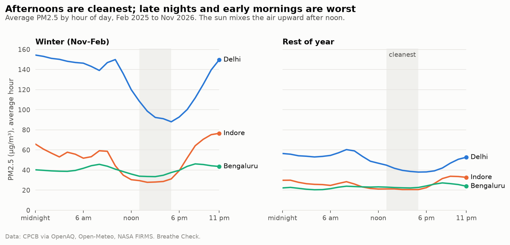

# Breathe Check

**Honest answers about India's air, from public data.**

Breathe Check answers three questions that matter to people who live in Indian cities:

1. **Did Delhi's GRAP pollution rules actually cut PM2.5, or did the weather do it?**
   Air gets cleaner when the wind picks up or it rains, so a simple before/after hides the truth. We remove the weather effect first, then compare Delhi-NCR with similar cities that have no GRAP.
2. **Indore keeps winning "India's cleanest city". Is its air clean too?**
   Cleanliness rankings measure waste, not air. We compare Indore's PM2.5 with India's limits, the WHO guideline and similar cities, season by season.
3. **When is the safest time to run outside tomorrow?**
   A next-24-hour forecast for your city, with a range showing how sure it is, and the best 2-hour window to go out.

Extras:

- **Cigarette equivalent**: today's air turned into "like smoking N cigarettes", so the numbers mean something.
- **Stubble-smoke check**: NASA fire counts in Punjab and Haryana plus wind direction answer "is crop-fire smoke blowing into Delhi today?"
- **Run-window calendar**: add one link to Google or Apple Calendar, and every evening it puts tomorrow's best 2-hour run window in your calendar, with the AQI. No app, no sign-up, no messages.

> Status: in progress. Live links will appear here as each part ships.

## How it works (short version)

| Step | What happens | Tool |
|---|---|---|
| Collect | Hourly PM2.5 from government (CPCB) stations, hourly weather, crop-fire counts | OpenAQ, Open-Meteo, NASA FIRMS |
| Store | Daily Parquet files in a public dataset | Hugging Face Datasets |
| Clean | Flag stuck sensors, zeros, impossible jumps and gaps; every rule is a tested check ([rules](docs/cleaning-rules.md)) | dbt + DuckDB |
| Analyse | Remove the weather effect, then test whether GRAP worked | LightGBM, statsmodels, synthetic control |
| Share | A full write-up with charts, a run-window web app, a calendar feed | Quarto on GitHub Pages, Vercel, iCalendar |

Everything runs on free tiers. No cloud bill. See [docs/adr](docs/adr) for why each choice was made.

## Results so far

Every number here comes from code in this repo that anyone can re-run. The full write-up so far: [first look at the data](reports/01-first-look.md).



- **Delhi in November and December** averages 213 µg/m³ of PM2.5: more than 3.5 times India's daily limit, about 14 times the WHO guideline.
- **Indore**, India's cleanest city by its waste ranking, crosses India's daily limit on an average winter day.
- **The day after Diwali** is about twice as polluted as the week before, in Delhi and in Indore.
- **Afternoons are cleanest.** In winter, Delhi's air at 5 pm has about 40% less PM2.5 than at midnight.
- **Weather alone** moves Delhi's winter PM2.5 by about 40%. That's why GRAP has to be judged on weather-adjusted numbers (coming in Part 6).

## Run it yourself

You need [uv](https://docs.astral.sh/uv/) and Python 3.11 or newer.

```bash
git clone https://github.com/Anushkajoshii/breathe-check.git
cd breathe-check
make setup
make test
```

Copy `.env.example` to `.env` and add your free API keys (the file says where to get each one). Then collect the data:

```bash
make stations      # find government PM2.5 stations near each city
make backfill      # full history (about an hour, because of API limits)
make daily         # just the last week; this is what the daily job runs
make clean-data    # run the cleaning rules and build the analysis tables
```

You can also skip collecting and read the public dataset on Hugging Face directly.

## Known limitations

- Monitoring stations are not spread evenly. Some cities have one or two, so one bad sensor can skew a whole city.
- OpenAQ republishes CPCB data. If CPCB data is late or missing, so is ours.
- The cigarette comparison is a rough rule of thumb from Berkeley Earth, not a medical measure.
- OpenAQ has almost no CPCB data from November 2022 to February 2025, so three winters are missing. See the [data card](docs/data-card.md).
- This is not medical advice. If you have asthma or a heart condition, follow your doctor.

## Licence

MIT. Data comes from its original sources under their own terms, listed in the [data card](docs/data-card.md).
