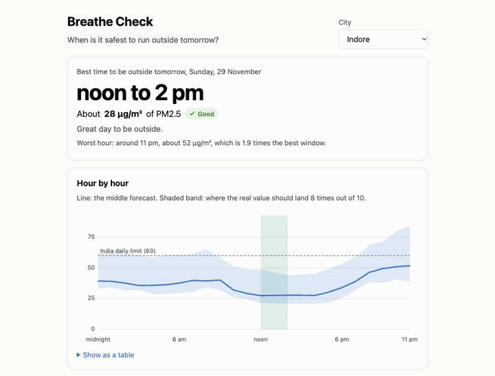
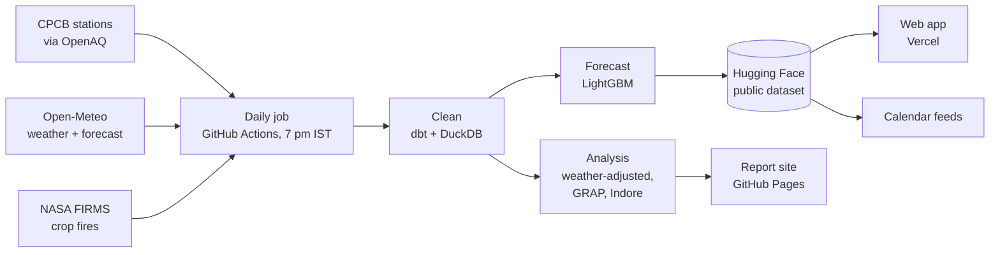

# Breathe Check

**Honest answers about India's air, from public data.**

[](https://github.com/Anushkajoshii/breathe-check/actions/workflows/ci.yml)
[](https://github.com/Anushkajoshii/breathe-check/actions/workflows/daily.yml)
[](https://anushkajoshii.github.io/breathe-check/)

**[Live app](https://breathecheck-aj.vercel.app)** · **[Full report](https://anushkajoshii.github.io/breathe-check/)** · **[Dataset](https://huggingface.co/datasets/Anushkajoshii/breathe-check-data)** · **[Design decisions](docs/adr)**

Three questions, answered with government air-quality readings, weather records and satellite fire counts for 20 Indian cities:

1. **Did Delhi's GRAP pollution rules actually cut PM2.5, or did the weather do it?**
2. **Indore keeps winning "India's cleanest city". Is its air clean too?**
3. **When is the safest time to run outside tomorrow?**



## For recruiters: what this project shows

An end-to-end data product, built solo: from messy government sensor data to a causal analysis, a calibrated forecast, and an app people use every evening. Everything below runs live and is tested.

| Skill | Where to see it |
|---|---|
| **Data engineering** | Three public APIs with rate limits, retries and resumable backfills ([`sources/`](src/breathe_check/sources)); a nearly 1-million-row hourly dataset as Parquet on Hugging Face; a self-healing daily pipeline ([`daily.py`](src/breathe_check/daily.py)) |
| **Data quality** | dbt + DuckDB cleaning rules, each tested on planted bad data ([`transform/`](transform), [rules](docs/cleaning-rules.md)); found a 3-year hole in the public record and sensors faking clean air |
| **Machine learning** | LightGBM weather models tested on unseen seasons (R² 0.80 for Delhi) with SHAP explanations; quantile forecasts calibrated to an honest 80% range ([forecast](reports/05-run-window.md)) |
| **Causal inference** | Difference-in-differences event study, placebo tests and synthetic control to separate a policy effect from weather and regression to the mean ([GRAP](reports/03-did-grap-work.md)) |
| **MLOps and automation** | GitHub Actions: CI on every PR, a nightly fetch → clean → forecast → publish job with failure handling and a public status file ([ADR-004](docs/adr/004-daily-update-on-github-actions.md)) |
| **Product and frontend** | React + TypeScript app on Vercel with a hand-built accessible SVG chart, light and dark themes, and calendar feeds for Google, Outlook and Apple ([`web/`](web)) |
| **Communication** | Five plain-language reports, six decision records, and a published report site ([site](https://anushkajoshii.github.io/breathe-check/)) |

**Numbers worth asking about:** 225 stations · 20 cities · 1.2M readings cleaned · 121 Python + 13 web tests · forecast miss of 12 µg/m³ per hour · an 80% range that holds 80% of the time · ₹0 running cost.

## What we found

| Question | Answer | Read more |
|---|---|---|
| Did GRAP's strictest stages cut PM2.5 in their first week? | **We can't find a cut.** Raw numbers swing +37% after Stage III/IV starts and −31% after it ends, but that's the bad spells themselves. With weather taken out and Delhi-NCR compared with similar cities without GRAP, the change is **+8% (90% range −5% to +23%)**, the same as on random dates. Four events is weak evidence, but a large quick cut is hard to believe. | [Did GRAP work?](reports/03-did-grap-work.md) |
| Is India's cleanest city's air clean? | **Cleanest of its neighbours, right at India's limit.** Indore averaged **41 µg/m³** (July 2025 to June 2026) against India's yearly limit of 40 and the WHO's 5: 8 times the WHO guideline, about 1.8 cigarettes a day. Judged against its weather, it's ordinary. | [Indore](reports/04-indore.md) |
| When is it safest to run tomorrow? | **Usually early afternoon.** On months it never saw, the forecast missed by **12 µg/m³** an hour, beat simple rules of thumb, and its range held the real value **80%** of the time. Its best window was among the day's cleanest third on **63%** of days (always 2 pm: 48%). | [When to run](reports/05-run-window.md) |

Along the way:

- **Weather alone moves Delhi's winter PM2.5 by about 40%.** A weather-only model predicts 80% of Delhi's day-to-day ups and downs on winters it never saw. [Taking the weather out](reports/02-weather-adjusted.md)
- **Delhi in November and December** averages 213 µg/m³: more than 3.5 times India's daily limit. The day after Diwali is about twice the week before, in Delhi *and* Indore. [First look](reports/01-first-look.md)
- **Broken sensors make cities look cleaner.** Offline stations sending zeros pulled Indore's average down from 41 to 37 until they were filtered out. [Cleaning rules](docs/cleaning-rules.md)
- **The public record has a three-year hole:** almost no CPCB data on OpenAQ from November 2022 to February 2025. [Data card](docs/data-card.md)

## What you can use

- **[The app](https://breathecheck-aj.vercel.app):** for each of 20 cities, tomorrow's best 2 hours to be outside, an hour-by-hour forecast with a range, the last 24 hours as cigarettes, and a crop-fire smoke check for Delhi-NCR.
- **[The calendar](docs/calendar.md):** add one link to Google Calendar, Outlook or Apple Calendar, and tomorrow's best window appears in your calendar every evening. For example: `https://breathecheck-aj.vercel.app/calendar/indore.ics`
- **[The report site](https://anushkajoshii.github.io/breathe-check/):** all five write-ups, the methods and every chart.
- **[The dataset](https://huggingface.co/datasets/Anushkajoshii/breathe-check-data):** raw and cleaned PM2.5, weather and fires since 2018, plus the daily forecasts, as Parquet and JSON. Updated every evening.

## How it works



| Part | What it does | Built with |
|---|---|---|
| Collect | Hourly and daily PM2.5 from 225 government stations, hourly weather and forecasts, satellite fire detections | OpenAQ, Open-Meteo, NASA FIRMS, httpx |
| Store | Parquet files, one per place per year, in a public dataset | Hugging Face Datasets |
| Clean | One tested rule per problem: impossible values, missing hours, stuck sensors, repeats, outliers, spikes | dbt + DuckDB |
| Take the weather out | A weather-only model per city, tested on seasons it never saw, explained with SHAP | LightGBM |
| Judge GRAP | Event study vs comparison cities, placebo dates, synthetic control | pandas, NumPy, SciPy |
| Forecast | Low, middle and high PM2.5 for every hour of tomorrow, with a calibrated range | LightGBM quantile regression |
| Update | Every evening: fetch, clean, forecast, calendar, upload, `status.json` | GitHub Actions |
| Share | Web app, calendar feeds, report site | React + Vite, iCalendar, MkDocs Material |

Everything runs on free tiers, with no server and no cloud bill. Each big choice has a short decision record in [docs/adr](docs/adr).

## Run it yourself

You need [uv](https://docs.astral.sh/uv/) (Python 3.12) and, for the app, Node 22.

```bash
git clone https://github.com/Anushkajoshii/breathe-check.git
cd breathe-check
make setup
make test
```

You can skip collecting data and use the public dataset: `uv run python -m breathe_check.ingest pull` downloads it. To collect it yourself, copy `.env.example` to `.env`, add the free keys it lists, and run:

| Command | What it does |
|---|---|
| `make stations` | find government PM2.5 stations near each city |
| `make backfill` | download the full history (about an hour, because of API limits) |
| `make clean-data` | run the cleaning rules and build the analysis tables |
| `make figures` | first-look charts |
| `make models` | weather-adjusted PM2.5 |
| `make grap` | did GRAP work? |
| `make indore` | Indore vs limits and its neighbours |
| `make run-window` | test the run-window forecast |
| `make forecast` | make tomorrow's forecasts |
| `make daily-local` | the whole daily update on your machine, without uploading |
| `make site-serve` | preview the report site |
| `cd web && npm install && npm run dev` | run the app at http://localhost:5173 |

## Quality checks

- **121 Python tests and 13 web tests run on every pull request.** Many of them run the real code on made-up data with a known answer. For example:
  - cleaning rules that must catch exactly the bad readings planted in fake data
  - a hidden 30% "policy" cut the weather-adjusted series has to find
  - a regional bad spell that must fool the naive GRAP estimate but not the comparison
- **dbt data tests run on the real data:** unique rows, GRAP only in Delhi-NCR, no impossible values after cleaning, a full day of weather behind every reading.
- **The daily job records what worked** in a public [`status.json`](https://huggingface.co/datasets/Anushkajoshii/breathe-check-data/blob/main/public/status.json) and keeps going if one data source is down.
- **The report site build fails on any broken link.**

## Limits

- **Missing winters:** OpenAQ has almost no CPCB data from November 2022 to February 2025, so three winters are missing, and the station network changed between the two periods.
- **Thin GRAP evidence:** only four strict-stage events fall inside the data. The GRAP result is weak evidence, and it says nothing about slower, season-long effects.
- **Uneven stations:** some cities have one or two stations, so a single bad sensor can matter. Indore had one station, in an industrial area, before 2025.
- **PM2.5 only:** India's official AQI also uses PM10, NO2, ozone and more. Ozone, which peaks on sunny afternoons, isn't in the run window.
- **Forecast testing:** the forecast was tested with real past weather, not past weather forecasts, so real misses will be somewhat bigger.
- **Cigarettes:** the comparison is Berkeley Earth's rough rule of thumb (22 µg/m³ for a day ≈ 1 cigarette), not a medical measure.
- **Not medical advice.** If you have asthma or a heart condition, follow your doctor.

## Licence

© 2026 Anushka Joshi. All rights reserved. The code is public so it can be read and reviewed; it isn't open source. Copying, reusing or redistributing any part of it, including the analysis, charts and models, needs written permission. See [LICENSE](LICENSE).

The underlying data keeps its providers' terms: CPCB and state pollution control boards (via OpenAQ), Open-Meteo (CC BY 4.0, from Copernicus ERA5), and NASA FIRMS. See the [data card](docs/data-card.md).

## About

Built by **Anushka Joshi** · [GitHub](https://github.com/Anushkajoshii)
