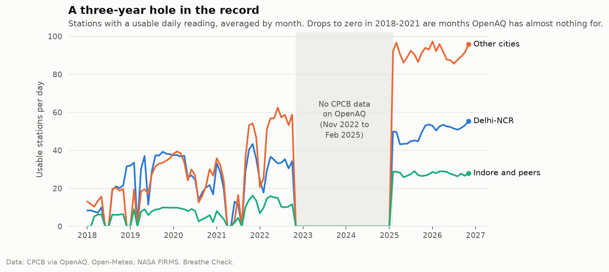
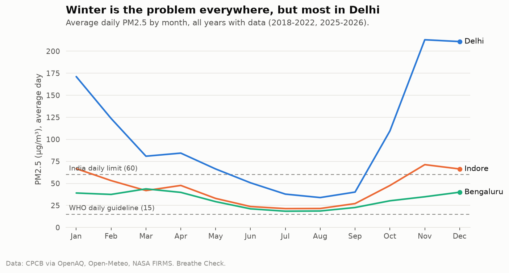
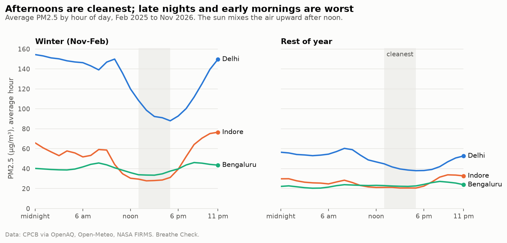
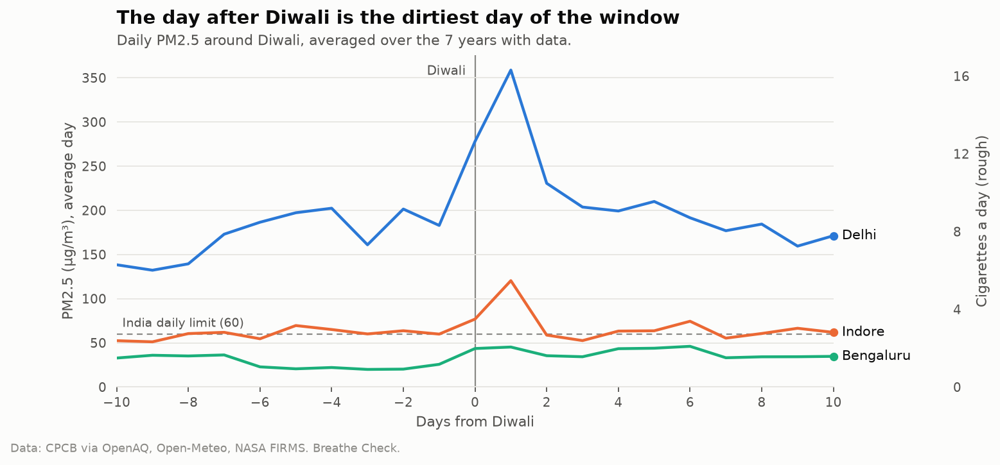
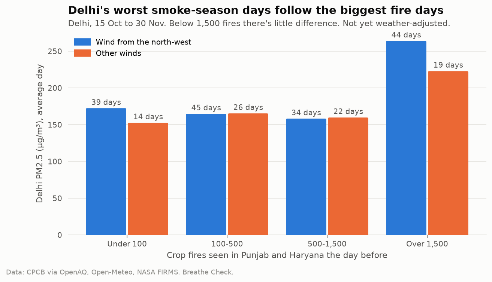
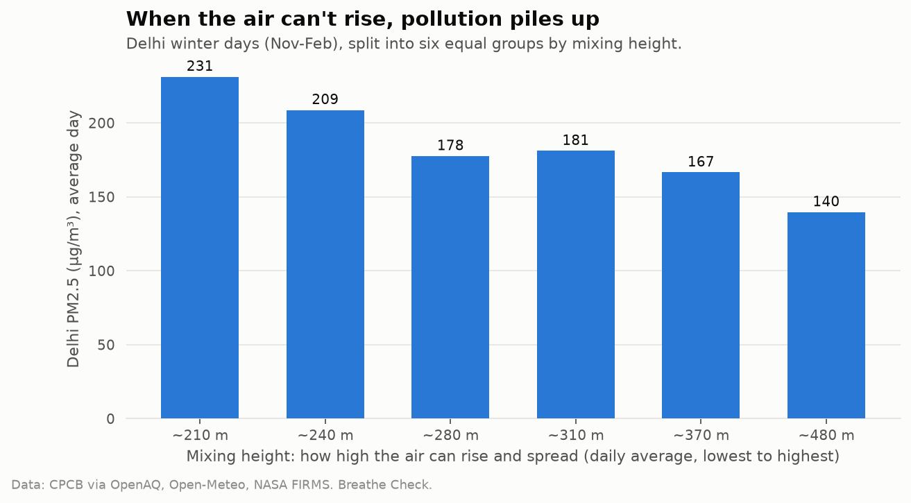

# First look at the data

What the cleaned data shows before any modelling. These are plain averages, so weather, season and the changing station network are all mixed in. Parts 6 to 8 untangle them.

Make the charts yourself: `make figures`.

## 1. A three-year hole in the record

- OpenAQ has no CPCB station data from **November 2022 to February 2025**. Every comparison in this project sticks to the periods on either side: four winters from 2018 to 2022, and the winters from 2025 on.
- **The network roughly doubled after 2025.** Delhi-NCR went from about 35 usable stations a day to about 50, so city averages before and after the gap come from different sets of stations.
- **2018 and 2021 have holes too.** Several whole months have almost no usable readings. That's why the GRAP analysis compares cities within the same period instead of across years.

## 2. Winter is the problem everywhere, but most in Delhi

| Month | Delhi | Indore | Bengaluru |
|---|---|---|---|
| November | 213 | 71 | 35 |
| December | 211 | 66 | 40 |
| January | 171 | 67 | 39 |
| July | 38 | 21 | 18 |

- **Delhi in November and December averages more than 3.5 times India's daily limit** (60 µg/m³), and about 14 times the WHO guideline (15).
- **Indore crosses India's daily limit on an average day from November to January.** Even its cleanest month (July, 21) is above the WHO guideline.
- **Bengaluru stays under India's limit all year,** but is still 2 to 3 times the WHO guideline.

## 3. Afternoons are cleanest

In winter (November to February, from Feb 2025 onwards):

| City | Cleanest hour | PM2.5 then | Worst hour | PM2.5 then |
|---|---|---|---|---|
| Delhi | 5 pm | 88 | Midnight | 154 |
| Indore | 2 pm | 28 | 11 pm | 77 |
| Bengaluru | 3 pm | 33 | 8 pm | 46 |

- **Why:** after noon, the sun warms the ground and the air near it rises and mixes with cleaner air above. At night the ground cools, a lid of warm air forms on top, and smoke from traffic, cooking and burning stays trapped near the ground.
- **For runners:** in winter, the early-morning run is the worst choice in all three cities. In Indore, a 2–5 pm run breathes about a third of the PM2.5 of a late-night one. This pattern is what the run-window forecast (Part 9) builds on.

## 4. The day after Diwali

The day after Diwali, compared with the week before the run-up (days 10 to 4 before), averaged over 7 years:

| City | Week before | Day after | Jump |
|---|---|---|---|
| Delhi | 167 | 359 | 2.1 times |
| Indore | 59 | 120 | 2.0 times |
| Bengaluru | 29 | 45 | 1.5 times |

- **Indore's jump is as big as Delhi's in relative terms.** Firecrackers aren't only a Delhi problem.
- **Delhi doesn't fully return to its pre-Diwali level within 10 days.** This is the start of the crop-fire season, and in most years nights are getting colder too. The GRAP analysis has to separate Diwali from both.

## 5. Crop fires and wind

Delhi, 15 October to 30 November:

- **Below about 1,500 fires the day before, there's no clear difference.** Delhi averages 150 to 170 µg/m³ whatever the fire count.
- **On the biggest fire days (over 1,500), Delhi averages 263 when the wind comes from the north-west** (where Punjab and Haryana are), against 222 with other winds.
- **This is only a first look.** Big fire days also tend to be calm, cold days in early November, so weather and the calendar are mixed in. Part 6 takes the weather out first.
- **Satellites can miss fires.** Counts fell from 97,000 (October–November 2021) to 10,400 (2025). Part of that may be farmers burning after the afternoon satellite pass. The real fall may be smaller.

## 6. When the air can't rise, pollution piles up

- **Mixing height** is how high air near the ground can rise and spread.
- On Delhi's winter days with the lowest mixing height (about 210 m), PM2.5 averages **231**. On days with the highest (about 480 m), it averages **140**. Same city, same season, 40% less PM2.5, just from the weather.

**Why it matters:** any before-and-after comparison of a rule like GRAP has to take weather out first. Stages are switched on when air is at its worst, which is usually when the air is still and low. Air would often get better afterwards anyway, once the weather turns. Part 6 builds a model that predicts PM2.5 from weather alone, so we can see what's left over.

## What this means for the next parts

1. **Weather moves PM2.5 a lot,** so the weather-adjusted ("deweathered") model comes first (Part 6).
2. **Diwali and crop fires overlap with GRAP stage changes,** so both need to be in the model, or the GRAP effect will absorb them.
3. **The station network changed,** so comparisons stay within one period.
