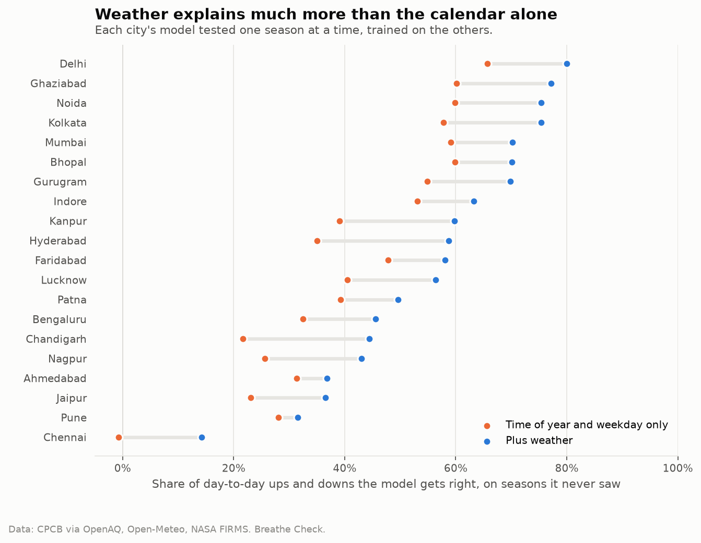
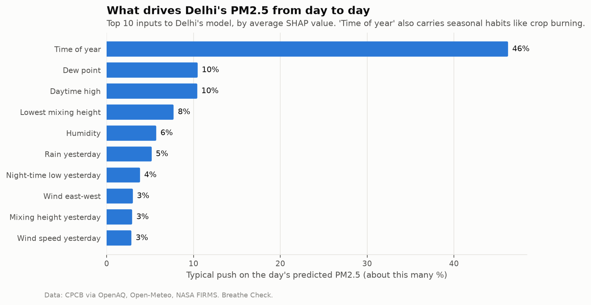
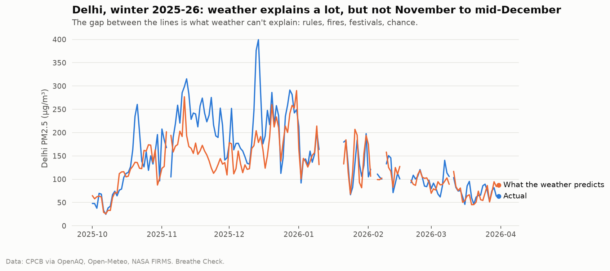

# Taking the weather out

Air gets cleaner when the wind picks up, when it rains, or when the sun lets the air rise and mix. It gets dirtier on still, cold, damp days. So when PM2.5 falls after a rule comes in, we can't tell whether the rule worked or the weather changed.

This part builds a model that answers one question for every city and every day: **what PM2.5 does this weather usually bring, at this time of year?** Whatever's left over (the gap between what happened and what the weather predicts) is what the rest of the project studies.

Run it yourself: `make models`.

## How the model works

- **One model per city:** LightGBM, a tree-based model that is good at curved, uneven relationships like "PM2.5 shoots up once the mixing height drops below about 250 m".
- **What it sees:** today's weather (wind speed and direction, mixing height, rain, humidity, dew point, temperature, pressure, cloud, sunshine), yesterday's wind, mixing height, rain, night-time low and humidity (pollution builds up over days), the time of year, and the day of the week.
- **What it never sees:** GRAP stages, crop fires, Diwali, or the year. So it can't "explain away" any of those.
- **It predicts the log of PM2.5,** so a miss of 20% counts the same on a clean day and on a smoggy one.

**How it's tested:** each season (July to June) is predicted by a model trained on all the *other* seasons. The model is always predicting a winter it has never seen, the way it would have to in real life. All the scores below are from these unseen seasons.

## How good is it?

"Share of ups and downs it gets right" is R² on the log scale. A typical miss is the median percentage error on a day.

| City | Gets right (weather) | Gets right (calendar only) | Typical miss |
|---|---|---|---|
| Delhi | 80% | 66% | 20% |
| Ghaziabad | 77% | 60% | 24% |
| Noida | 75% | 60% | 27% |
| Kolkata | 75% | 58% | 23% |
| Indore | 63% | 53% | 22% |
| Bengaluru | 46% | 32% | 20% |
| Chennai | 14% | about 0% | 27% |

The full table for all 20 cities is in `data/clean/deweather_scores.parquet`.

- **Weather adds something in every city:** 4 to 24 percentage points over a model that only knows the date, and 10 or more in 15 of the 20 cities.
- **The model is best in the north,** where winter inversions trap smoke and the weather really is in charge.
- **It's weakest in Chennai, Pune, Jaipur and Ahmedabad.** In Chennai, sea breezes keep PM2.5 low and steady, so day-to-day changes come more from local sources than from the weather. For these four cities, the weather-adjusted series is less reliable, and the report says so whenever it uses them.

## What drives Delhi's PM2.5

Measured with SHAP values: how hard each input pushes each day's prediction up or down, on average.

- **Time of year is by far the biggest input (about 46%).** Be careful with this one. It isn't only weather: it also carries everything that happens every winter, like crop burning, heating fires, festivals and the GRAP season itself. So the weather-adjusted series keeps the *usual* winter level and removes only the day-to-day weather swings. Part 7 deals with this by comparing Delhi with cities that have the same winters but no GRAP.
- **After that come dew point and the daytime high (about 10% each), and the lowest mixing height (8%).** Damp, cool days with a low lid on the air are the smoggiest.
- **Yesterday's weather matters too.** Rain and the night-time low from the day before are in the top ten, because a still night lets pollution build into the next day.

## What weather can't explain

Delhi, month by month, 2025-26 (actual vs what the weather predicts):

| Month | Actual | Weather predicts | Actual ÷ predicted |
|---|---|---|---|
| October 2025 | 108 | 100 | 1.04 |
| **November 2025** | **225** | **160** | **1.48** |
| December 2025 | 220 | 181 | 1.12 |
| January 2026 | 146 | 143 | 1.00 |
| February 2026 | 107 | 111 | 1.00 |

- **From January on, Delhi was almost exactly as polluted as its weather predicted.**
- **November 2025 was 48% dirtier than the weather explains.** That was the month Stage III was switched on (11 to 26 November). This does **not** mean GRAP made the air worse: stages are switched on *because* the air is unusually bad. That's the classic trap ("reverse causation"), and Part 7 is built to handle it.
- **What else was going on that November?** Diwali fell on 20 October, and crop-fire counts that autumn were the lowest since at least 2018 (10,400 in October–November). So whatever pushed November so far above the weather, it wasn't obviously more fires. Possible reasons include burning the satellite missed, local sources, or the model under-predicting a rare weather pattern. Part 7 looks at it with comparison cities.

## A first hint about the long run

Across all 20 cities, the typical day's actual ÷ predicted ratio falls over time:

| Season | Actual ÷ predicted (all cities, median day) |
|---|---|
| 2018-19 | 1.20 |
| 2019-20 | 0.95 |
| 2021-22 | 1.05 |
| 2025-26 | 0.94 |

That would mean air in 2025-26 was cleaner than the same weather brought in 2018-19. **Don't read too much into it yet:**
- **The station network changed** between the two periods.
- **The time-of-year input soaks up part of any long-term trend.**

Part 8 looks at this properly.

## Files this adds

| File | What's in it |
|---|---|
| `data/clean/city_day_adjusted.parquet` | For every city-day: actual PM2.5, what the weather predicts (`expected`, from a model that never saw that season), `ratio` (actual ÷ expected) and `pm25_adjusted` (the ratio times the city's usual level for that week of the year) |
| `data/clean/deweather_scores.parquet` | Test scores for each city, with and without weather |

## Limits

- **One weather point per city** (the city centre). A big city's weather varies more than that.
- **Weather data comes from a reanalysis** (ERA5), not a weather station. It's very good for wind and temperature, but rougher for mixing height.
- **The model has no idea about rare events** it hasn't seen before, like a dust storm from Rajasthan. Those show up as a big ratio on that day.
