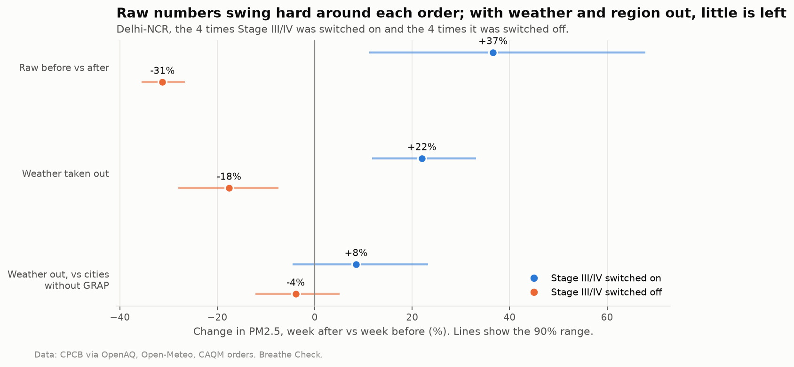
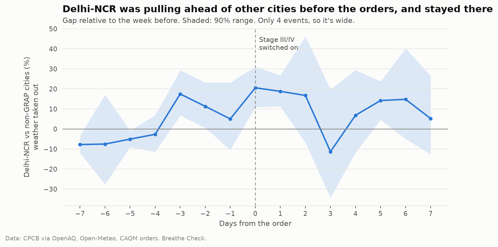
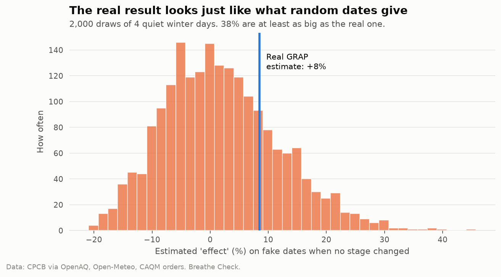

# Did GRAP work?

**Short answer: in the week after Delhi-NCR's strictest stages (III and IV) were switched on, we can't find any drop in PM2.5 once weather and the wider region are taken into account. Our best estimate is +8%, with a 90% range from −5% to +23%. With only four events since 2025, that's weak evidence either way. But it does make a large, quick cut (say 10% or more) hard to believe.**

Run it yourself: `make grap`.

## The trap in "PM2.5 fell after the ban"

GRAP stages are switched on *because* the air has turned bad, and they're switched off once it improves. Bad spells start and end with the weather. So:
- Right after a stage is switched **off**, PM2.5 almost always falls. The air was already clearing; that's why the stage was lifted.
- Right after a stage is switched **on**, PM2.5 often keeps *rising*, because orders now come early, on forecasts of a bad spell that hasn't peaked yet.

Neither tells us what the rules did. To get closer, we remove two things in turn.

## Step by step

**Change in Delhi-NCR's PM2.5, week after vs week before the order (90% range in brackets):**

| | Stage III/IV switched **on** (4 times) | Stage III/IV switched **off** (4 times) |
|---|---|---|
| 1. Raw before vs after | **+37%** (+11 to +68) | **−31%** (−36 to −27) |
| 2. Weather taken out (Part 6) | +22% (+12 to +33) | −18% (−28 to −7) |
| 3. Weather out, **compared with cities without GRAP** | **+8%** (−5 to +23) | **−4%** (−12 to +5) |

- **Step 1** looks dramatic: air gets much worse after the strict stages start, and much better after they end. That's the bad spell itself, not the rules.
- **Step 2** takes the weather out. Most of the swing is still there, because these spells are partly regional: smoke, festivals and inversions across the whole northern plain.
- **Step 3** compares Delhi-NCR (Delhi, Gurugram, Noida, Ghaziabad, Faridabad) with **Lucknow, Kanpur, Patna and Chandigarh** over the same days. They share the same plain, winters and smoke, but have no GRAP. Whatever hits the whole region cancels out. What's left is close to zero, in both directions.

**What this means:** if Stage III or IV cut Delhi-NCR's PM2.5 by a large amount in its first week, step 3 should show a clear drop after "on" and a clear rise after "off". It shows neither.

## Day by day

Delhi-NCR's gap with the comparison cities, day by day, relative to the week before each "on" order:

- **Before the order:** Delhi-NCR pulls ahead of the comparison cities, from −8% a week before to +17% three days before. This is the selection effect made visible: stages are switched on when Delhi-NCR is getting worse *faster* than its neighbours.
- **After the order:** the gap stays at roughly +5% to +20% and doesn't come back down within a week. If the rules were biting, we'd expect Delhi-NCR to fall back towards the comparison cities faster than it does.

## Could this be luck?

We pretended GRAP was switched on at random quiet winter days, when no stage actually changed, and ran the same step-3 calculation 2,000 times.

- **On fake dates,** the results run from −13% to +20% in the middle 90%.
- **The real +8% sits well inside that.** 38% of fake runs are at least as far from zero.

So the real result is just what you'd expect from ordinary day-to-day noise. It is neither a clear benefit nor a clear harm.

## Other checks

Step 3 for the "switched on" events, re-run different ways:

| Check | Estimate | 90% range |
|---|---|---|
| Main result | +8% | −5 to +23 |
| Counting from the **day after** the order (orders often come out in the afternoon) | +3% | −12 to +21 |
| Leaving out the 4 GRAP dates marked "needs review" | +8% | −5 to +23 (the unclear dates are all outside these events) |
| Leaving out Diwali week (3 events left) | +15% | +1 to +30 |
| **Milder Stage I** switched on (10 events) | −3% | −7 to +2 |

- **None of these show a drop.** The closest is Stage I, at −3%, which is small and not clearly different from zero.
- **Without Diwali week,** the estimate goes up, not down. Leaving that week out drops the 6 November 2026 order, which came two days before Diwali that year. The other three events on their own still show no drop.

**Synthetic control: inconclusive.** We also built, for each event, a weighted mix of non-GRAP cities that tracked Delhi over the 45 days before.
- **The fit was poor:** a typical error of 24–34% per day *before* the event. No mix of other cities follows Delhi closely day by day.
- **So its four estimates** (+63%, −2%, +3% and −44%) are too noisy to use. We report them here for completeness and don't rely on them.

## What this does and doesn't tell us

**It does tell us:**
- A naive "PM2.5 fell after the ban" or "PM2.5 rose after the ban" claim says almost nothing about the rules. The weather and the region drive those swings.
- In the first week, the strictest stages don't produce a cut big enough to see against Delhi-NCR's neighbours, with the data we have.

**It doesn't tell us:**
- **Whether GRAP helps over a whole season.** Many measures (construction dust control, the ban on older diesel vehicles, cleaner industrial fuel) may work slowly and steadily, and this method only looks one week either side of each switch.
- **Whether things would have been worse without GRAP.** If Delhi-NCR's spells would have been even worse without the rules, a zero here could hide a real benefit. We can't see that world.
- **Whether the rules are being followed.** A rule that isn't enforced can't show up in the air.

**Why the evidence is weak:**
- **Only four strict-stage events** fall inside our data (February 2025 onwards). The three winters before that are missing from OpenAQ.
- **The comparison cities have fewer stations,** so their averages are noisier.

## The original GRAP (2017 to 2022)

We hoped to compare the original GRAP winters with the revised ones. It doesn't work with this data:
- the original GRAP had no published day-by-day stage record
- the station networks in Delhi-NCR and the comparison cities changed differently between 2022 and 2025

So any shift in the gap between them would be mostly about which stations exist, not about the rules. We leave it out rather than report a number we don't trust.

## Methods, for the curious

- **Unit:** a city-day. **Outcome:** log of (actual PM2.5 ÷ what the weather predicts), from Part 6's out-of-season model.
- **Treated group:** the 5 Delhi-NCR cities. **Comparison group:** the 4 Indo-Gangetic plain cities without GRAP.
- **Window:** 7 days before the order date vs days 1 to 7 after. Day 0 is left out, because the order lands partway through it.
- **Uncertainty:** the 90% ranges come from resampling the events themselves (bootstrap). With 4 events, these ranges are rough.
- **Placebo:** quiet winter days with no stage change within 7 days either side, the same calculation, 2,000 random draws of 4.
- **Synthetic control:** non-negative weights that add up to 1, fitted on the 45 days before, with donors from all 15 non-GRAP cities.
- Code: `src/breathe_check/analysis/grap_effect.py`. Tests (`tests/test_grap_effect.py`) check, on made-up data, that a regional bad spell fools the naive estimate but not the comparison, and that a real 30% cut is found.
