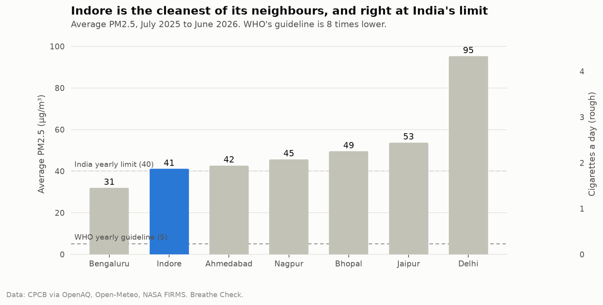
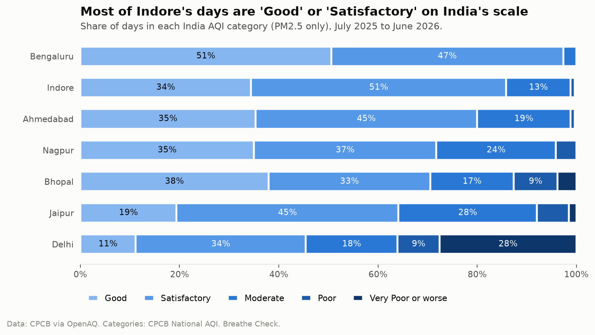
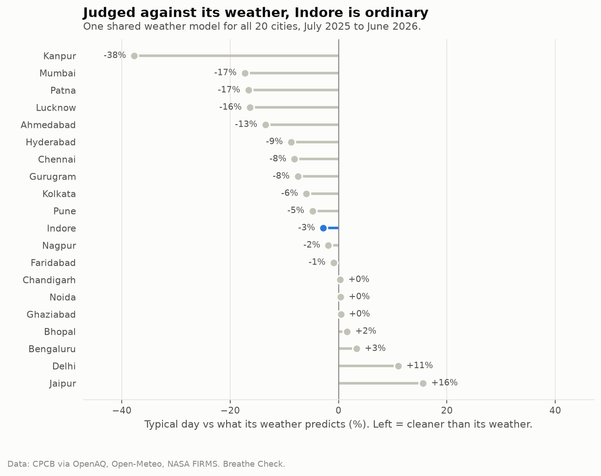

# India's cleanest city. Is its air clean?

Indore was ranked India's cleanest city in the government's Swachh Survekshan survey every year from 2017 to 2023. That survey scores waste collection, sanitation and how clean the streets look. It doesn't measure the air. So we asked: how clean is the air Indore's people breathe?

**Short answer: Indore's air is the cleanest of its neighbours, but it sits right at India's yearly limit and is about 8 times over the WHO guideline. Judged against its weather, it's ordinary. Its lead over Bhopal and Jaipur comes mostly from weather and geography, not from anything Indore is doing differently.**

Run it yourself: `make indore`.

## Which year we use

**July 2025 to June 2026** is the most recent full year with data on almost every day (340 days) for every city, and the first full year since Indore's network grew to five or six government stations. Before February 2025, Indore had one station, in the Pithampur industrial area about 25 km from the city centre, so earlier "Indore" numbers are really Pithampur numbers.

## 1. Against the limits

| City | Average PM2.5 | vs India's yearly limit (40) | vs WHO guideline (5) | Cigarettes a day (rough) |
|---|---|---|---|---|
| Bengaluru | 31 | 0.8 times | 6 times | 1.4 |
| **Indore** | **41** | **1.0 times (just over)** | **8 times** | **1.8** |
| Ahmedabad | 42 | 1.1 times | 8 times | 1.9 |
| Nagpur | 45 | 1.1 times | 9 times | 2.1 |
| Bhopal | 49 | 1.2 times | 10 times | 2.2 |
| Jaipur | 53 | 1.3 times | 11 times | 2.4 |
| Delhi | 95 | 2.4 times | 19 times | 4.3 |

- **Indore is the cleanest of the five central and western cities we compared it with.** Only Bengaluru, of the cities in this table, is cleaner.
- **Indore sits right at India's yearly limit:** 40.6 against a limit of 40.
- **Measured against the WHO guideline, no city here is close.** Indore is 8 times over.

## 2. Day by day

On India's AQI scale (PM2.5 only), Indore's days in 2025-26 were:
- **34% "Good"** and **51% "Satisfactory"**
- **13% "Moderate"** and **1% "Poor"**, with almost no days worse than that

**Over the daily limits:**
- **India's daily limit (60):** Indore went over on **48 days**. That compares with 68 in Ahmedabad, 96 in Nagpur, 100 in Bhopal, 122 in Jaipur and 186 in Delhi.
- **WHO's daily guideline (15):** Indore went over on **326 of 340 days**.

**Winter is when it counts.** Indore's average was 57 in winter (November to February) against 33 the rest of the year. Of its 48 days over India's limit, 33 fall in those four months. Most of the rest come in October (7, around Diwali) and April (6, dusty pre-monsoon days).

## 3. Judged against its weather

Weather alone makes some cities cleaner than others: sea breezes, wind, how often cold still nights trap smoke. To compare cities fairly, we trained **one shared weather model** on all 20 cities. It predicts PM2.5 from weather and the time of year only, and **it doesn't know which city it's predicting**, so every city is judged by the same rule. As in Part 6, every prediction comes from a model that didn't see that season.

A city below zero is cleaner than its weather would suggest. Above zero, it's dirtier.

| City | Typical day vs what its weather predicts |
|---|---|
| Ahmedabad | −13% |
| **Indore** | **−3%** |
| Nagpur | −2% |
| Bhopal | +2% |
| Jaipur | +16% |
| Delhi | +11% |

- **Indore is about as clean as its weather predicts.** Its lead over Bhopal and Jaipur on raw numbers is mostly weather, not something extra Indore is doing.
- **Jaipur and Delhi are dirtier than their weather explains.** That points to more local sources: dust, traffic, industry, burning.
- **Ahmedabad does better than its weather predicts,** by 13%.

**Read this ranking with care.** The shared model only knows weather and the time of year, not geography. A city near the coast, in a river valley or downwind of a big industrial area can sit far from zero for reasons that aren't "doing better" or "doing worse". Kanpur at −38% is the clearest example: its weather looks like the rest of the northern plain, but its stations read lower than that weather usually brings. We'd treat its number as a puzzle about the stations, not a win.

## 4. One station, six years apart

Because Indore's network changed, we can't compare "Indore 2019-20" with "Indore 2025-26" as a whole. But one station, **Pithampur (Sector-2 Industrial Area)**, has data for both full years:

| Year | Pithampur average PM2.5 | Days |
|---|---|---|
| 2019-20 | 39 | 340 |
| 2025-26 | 55 | 331 |

- **That's 40% higher,** even though Indore's weather in 2025-26 was slightly *cleaner* than in 2019-20. The weather model expects 40 µg/m³ in 2025-26, against 44 in 2019-20.
- **Be careful with this one:**
  - The station got a **new sensor in February 2025** (OpenAQ lists it under a new ID). Part of a jump like this can come from the new instrument, not the air.
  - Pithampur is an industrial area outside the city, so it doesn't speak for Indore's homes.
  - It's still worth asking the state pollution board whether industrial emissions around Pithampur have risen.

## What this means

- **"Cleanest city" and "clean air" are different things.** Indore's streets win the national survey, but its air sits at India's limit and is 8 times the WHO guideline. On about 14% of days, two-thirds of them in winter, it's over India's own daily limit.
- **Indore's relative advantage looks mostly natural.** Judged against its weather, it's average. Clean streets don't seem to have bought cleaner air beyond what geography gives.
- **For a resident:** winter evenings and nights are when Indore's air is at its worst (Part 5). The safest time for exercise outside is early afternoon. Part 9 turns that into a daily forecast.

## Limits

- **One full recent year,** so this is a snapshot, not a trend. Another year will tell us more.
- **PM2.5 only.** India's official AQI also looks at PM10, NO2, ozone and other pollutants, so the official category on a given day can be worse than ours.
- **Station locations matter.** Indore's stations (Residency Area, Airport Area, Regional Park, Maguda Nagar, Vijay Nagar, and Pithampur just outside) are a mix of residential and green areas, so they may read cleaner or dirtier than where a given person lives.

## Files

| File | What's in it |
|---|---|
| `data/clean/city_season_summary.parquet` | Every city and full year: average, days over each limit, cigarette equivalent |
| `data/clean/weather_fair_ranking.parquet` | Each city's actual vs shared-weather-model prediction, 2025-26 |
