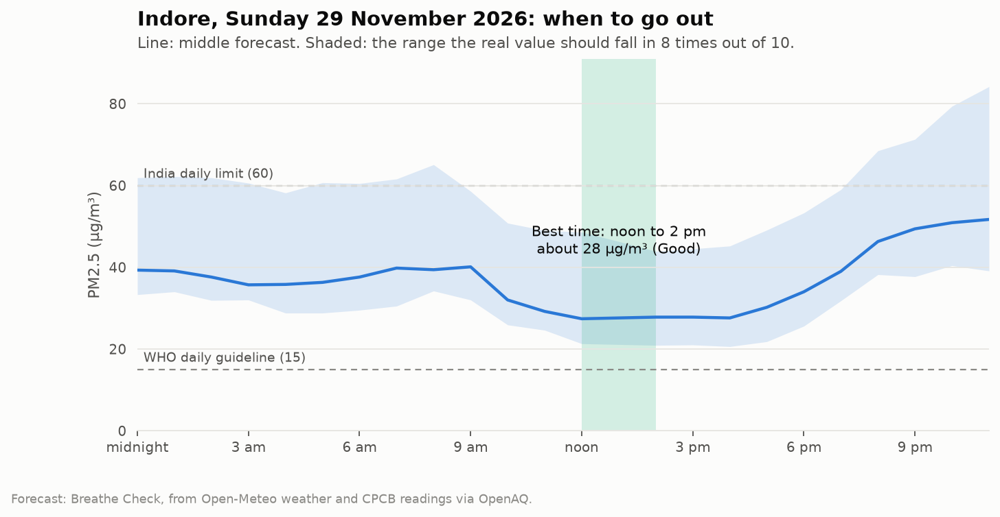
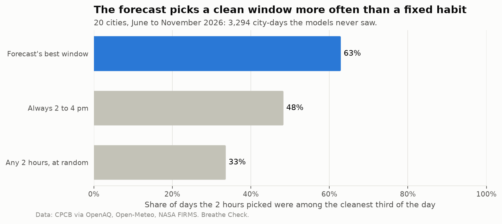

# When is it safest to run outside tomorrow?

The part of Breathe Check people use every day. Each evening, for each of the 20 cities, it forecasts PM2.5 for every hour of the next day, with a range, and picks the **best 2 hours to be outside** between 5 am and 10 pm.

Make tomorrow's forecast yourself: `make forecast`. Test it: `make run-window`.

## How it works

**Three LightGBM models,** one each for the low, middle and high value of each hour (the 10th, 50th and 90th percentiles). They're trained on every city and every hour from February 2025, and see only what's known the evening before:
- **tomorrow's weather forecast for each hour:** wind speed and direction, mixing height, rain, humidity, temperature, cloud, sunshine
- **the hour, the time of year, the day of the week, and the city**
- **today's air:** the average from midnight to 6 pm, and the 5 pm reading

**Best window:** the 2 back-to-back hours with the lowest middle forecast, starting between 5 am and 8 pm.

**Keeping the range honest:**
- Quantile models tend to be a little too sure of themselves. Here the plain range held the real value only 73% of the time.
- **The fix:** we hold back the last 60 days of training data and measure how much the range needs widening to hold the real value 80% of the time there. That widening (1.2 times, on the log scale) is applied to every forecast.

## How well it works

Tested on **June to November 2026**. The models were trained only on data before June 2026, so every one of these hours was new to them.

| | June to Nov 2026 | Winter part (15 Oct to 26 Nov) |
|---|---|---|
| Typical miss per hour | **12 µg/m³** | 20 µg/m³ |
| …"tomorrow = today's level" | 14 | 26 |
| …"the usual for this city, hour and month" | 18 | 32 |
| Real value inside the low–high range | **80%** | 78% |
| Real value below the range / above it | 11% / 9% | 14% / 9% |

**The forecast beats both rules of thumb.** That's most clearly true in winter, when the miss is 20 against 26 and 32.

### Does the "best window" actually help?

For each city-day, we checked whether the 2 hours the forecast picked really were among the cleanest third of that day's 2-hour windows.

| Way of choosing | June to Nov | Winter part |
|---|---|---|
| **The forecast's best window** | **63%** | **76%** |
| Always 2 to 4 pm | 48% | 77% |
| Any 2 hours at random | 33% | 33% |

**Be honest about winter.** From mid-October, early afternoon is reliably the cleanest time almost everywhere: the sun lifts the lid of cold air, as Part 5 showed. So "just go at 2 pm" does as well as the forecast. The forecast earns its keep the rest of the year, on unusual days, and by telling you *how* clean the window will be, not just when.

**Against the habit of a 7–9 am run:**
- **In winter,** the forecast's window has a **28% lower** PM2.5 on a typical day.
- **Over June to November as a whole,** it's 10% lower.

### By month

| Month (2026) | Typical miss | Inside the range |
|---|---|---|
| June | 10 | 80% |
| July | 9 | 81% |
| August | 8 | 80% |
| September | 8 | 81% |
| October | 12 | 86% |
| November | 24 | 74% |

**November is the hardest month.** Smoke, festivals and sharp cold snaps make for sudden jumps the weather forecast can't see coming. The range also holds the real value less often then (74%).

## Today's air, as cigarettes

Each city's card also shows the **last 24 hours**: average PM2.5, the India AQI category, plain advice, and the cigarette equivalent (22 µg/m³ for a day ≈ 1 cigarette, Berkeley Earth's rule of thumb).

## Stubble-smoke check (Delhi-NCR only)

**"Likely"** when both of these are true:
- **more than 1,500 confident fires** were seen in Punjab and Haryana on the latest day of satellite data
- the wind is forecast to blow **from the north-west** (where the fields are) for at least half of tomorrow's hours

Otherwise it says **"Unlikely"**, and outside October and November, "Not burning season".

**Checked on Delhi's October–November days, 2018 to 2026:**

| Smoke check said | Days | Delhi PM2.5 | Compared with its weather |
|---|---|---|---|
| Likely | 40 | 252 | 14% dirtier |
| Unlikely | 283 | 143 | about as expected (1% above) |

**We tried a middle "Possible" level** (more than 500 fires, wind from the north-west at least 30% of the time). Once weather was taken out, those days were no different from normal, so we dropped it rather than show a level that means nothing.

**A satellite note.** NASA's near-real-time fire feed from the Suomi NPP satellite, which our long record comes from, stopped on 2 November 2026. From then on, the fire count comes from NOAA-20, which carries the same VIIRS instrument. On 1 and 2 November, when both were available, they counted 235 vs 268 and 245 vs 258 fires, close enough for this check.

## What the app gets

`data/public/forecast/<city>.json` holds, for each city:
- tomorrow's 24 hours, each with low, middle, high and the AQI category
- the best window, with its category and advice
- the worst hour
- the last-24-hours card
- the smoke check (Delhi-NCR cities)
- when the forecast was made, and which day's air it's based on

There's also an `index.json` listing every city. The web app (Part 11) and the calendar feed (Part 12) read these files.

## Limits

- **The test used real past weather, not past forecasts.** In daily use, the weather itself is a forecast and will sometimes be wrong, so real misses will be somewhat bigger than in the table.
- **Each city's PM2.5 is the average of up to 4 stations.** Your street can be cleaner or dirtier, especially near traffic.
- **PM2.5 only.** Ozone, which peaks on sunny afternoons, isn't included. In some cities in summer, the cleanest hours for PM2.5 can be the worst for ozone.
- **This is not medical advice.** If you have asthma or a heart condition, follow your doctor.
