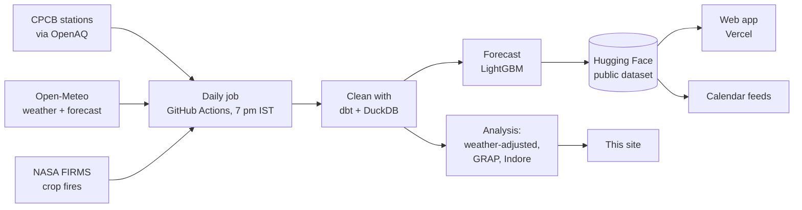

# Breathe Check

**Honest answers about India's air, from public data.**

Three questions, answered with government air-quality readings, weather records and satellite fire counts for 20 Indian cities:

1. **Did Delhi's GRAP pollution rules actually cut PM2.5, or did the weather do it?**
2. **Indore keeps winning "India's cleanest city". Is its air clean too?**
3. **When is the safest time to run outside tomorrow?**

[Open the app](https://breathe-check-flax.vercel.app){ .md-button .md-button--primary } [Add the run-window calendar](about/calendar.md){ .md-button } [Get the data](https://huggingface.co/datasets/Anushkajoshii/breathe-check-data){ .md-button }

## The short answers

**Did GRAP's strictest stages cut PM2.5 in their first week? We can't find it.**
Raw numbers swing hard around each order: +37% after Stage III/IV is switched on, −31% after it's switched off. That's the bad spells themselves, not the rules. With the weather taken out and Delhi-NCR compared with similar cities that have no GRAP, the change is +8% (90% range −5% to +23%), the same as on random dates. With only four events in the data, this is weak evidence either way, but a large, quick cut is hard to believe. [Read more](findings/03-did-grap-work.md)

**Indore's air is the cleanest of its neighbours, and right at India's limit.**
In July 2025 to June 2026, Indore averaged 41 µg/m³ against India's yearly limit of 40 and the WHO's guideline of 5. That's 8 times the WHO guideline, or about 1.8 cigarettes a day. Judged against its weather, it's ordinary: its lead over Bhopal and Jaipur comes mostly from weather and geography. [Read more](findings/04-indore.md)

**The best time to be outside is usually early afternoon, and the forecast tells you how clean it will be.**
On months it never saw, the forecast missed by about 12 µg/m³ an hour, beat simple rules of thumb, and its range held the real value 80% of the time. Its best window was among the day's cleanest third on 63% of days, against 48% for always going at 2 pm. In winter, "just go at 2 pm" works as well. [Read more](findings/05-run-window.md)

## Also found along the way

- **There's a three-year hole in the public record.** OpenAQ has almost no CPCB data from November 2022 to February 2025. [The data](about/data-card.md)
- **Broken sensors make cities look cleaner.** Offline stations sending zeros pulled Indore's 2026 average from 41 down to 37 until they were filtered out. [Cleaning rules](about/cleaning-rules.md)
- **Weather alone moves Delhi's winter PM2.5 by about 40%.** A weather-only model predicts 80% of Delhi's day-to-day ups and downs on winters it never saw. [Taking the weather out](findings/02-weather-adjusted.md)
- **The day after Diwali is about twice as polluted as the week before,** in Delhi and in Indore. [First look](findings/01-first-look.md)
- **NASA's main near-real-time fire feed stopped on 2 November 2026.** The project now switches to NOAA-20 automatically. [When to run tomorrow](findings/05-run-window.md)

{ loading=lazy }

## How it works

Everything runs on free tiers, with no server and no cloud bill. Every number on this site comes from code in the [GitHub repo](https://github.com/Anushkajoshii/breathe-check), and anyone can re-run it.

## Not medical advice

These are estimates from public monitors and models. Your street can be cleaner or dirtier than the city average. If you have asthma or a heart condition, follow your doctor.
